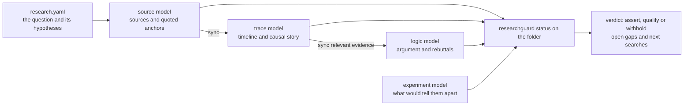

# ResearchGuard

<p align="center"><strong>Your AI tells a confident causal story that its sources do not support. ResearchGuard keeps the sources, the timeline and the argument as separate, linked models whose constraints can be checked, and tells the AI whether a claim may be asserted, must be qualified, or must be withheld.</strong></p>

| Version | Runtime | Package | License |
| --- | --- | --- | --- |
| `v0.6.0` | Python 3.11+ | `researchguard` | MIT |

ResearchGuard is a Python tool and an agent skill (Claude Code, Codex) for one question at a time. The question lives
in a folder: the hypotheses, the sources with the exact passages quoted from them (anchors), a timeline, an argument
and, if useful, a set of experiments that would tell the hypotheses apart. The AI builds these explicit models; native tools check their bindings, constraints and disagreements,
then compute a bounded verdict from the declared evidence and argument structure.

## 30 seconds: did the Ever Given cause the 2021 freight rate rise?

A user asks: *Did the Ever Given grounding in the Suez Canal (23–29 March 2021) cause the 2021 Asia–Europe container
freight rate rise?*

**Without ResearchGuard**, the AI may answer from the story everybody remembers:

> Yes. The six-day blockage of the Suez Canal disrupted Asia–Europe shipping and caused the 2021 freight rate rise.

**With ResearchGuard**, the AI keeps the question as a research folder and reads its status. The folder ships as
`examples/research/evergiven/`:

```console
$ researchguard status examples/research/evergiven | head -19
# Did the Ever Given grounding (23–29 March 2021) cause the 2021 Asia–Europe container freight rate rise?

## Verdict

- search: continue_search
- root_claim: h_suez: withhold — h_suez is UNDECIDED: R_h_suez_anc-transpacific (Rebuttal) blocks it; R_h_suez_anc-unctad-surge (Rebuttal) blocks it; R_pretrend (Rebuttal) blocks it; h_demand (Claim) blocks it.
- live_hypotheses: h_demand, h_yantian
- contested: false
- errors: 0

Models: source ok (source.yaml) | trace ok (trace.yaml) | logic ok (logic.yaml) | experiment ok (experiment.json)

## Hypotheses

| id | text | logic | trace | experiment |
|---|---|---|---|---|
| h_suez | The Suez blockage caused the rise. | UNDECIDED 0.16 | rank 2, support 0.33, not live, causal 0.33 | eliminated |
| h_demand | Demand rebound and container scarcity drove the rise. | IN 0.74 | rank 1, support 0.45, live | consistent |
| h_yantian | The Yantian disruption drove the rise. | not listed | not listed | consistent |
```

The claim the AI wanted to make is `h_suez`, and its wording licence is **withhold**. The argument lists four
blockers, including the pre-trend rebuttal and the competing demand claim. The timeline does not keep h_suez live,
and the declared experiment record eliminates it. `search: continue_search` says the counter-source search is unfinished.
The answer licensed by this folder is therefore: *these records do not support asserting that the blockage caused the
rise; demand rebound remains a live alternative, and the Suez claim is withheld.* The page also lists source-bound
evidence, open gaps and next searches, so the AI can choose the next useful check.

### The shortcut it closes

The AI's easiest way to rescue its first answer is to type a supporting sentence straight into the argument, for example
a newspaper line "the blockage alone doubled Asia–Europe spot rates in April 2021", without adding the source it came
from. When the folder declares a source model, that evidence has no source identity to check against. From `v0.6.0` it
is an error:

```console
$ researchguard status <copy> | tail -4
## Problems

- error evidence_not_in_source:logic:E_lloyds (its provenance names no source_id; add the anchor with researchguard source add-anchor, then run researchguard sync <folder>)
- warning hypothesis_not_in_logic:h_yantian
```

Re-enter the evidence through the source model, starting from a clean candidate copy. Quote the passage as an anchor,
sync the copy, then compare it with the current folder before accepting it. Sync preserves authored nodes; an existing
unanchored insertion needs an explicit source binding rather than silent deletion. To keep the original `E_lloyds`,
set its provenance to `origin_kind: external_source`, `source_id: src-lloyds`, `locator: anc-lloyds` and the anchor's
exact `quote`; remove or refresh a stale `source_reference`. Its text and authored edges can stay. The clean-copy route is:

```console
$ cp -r examples/research/evergiven ../evergiven-copy
$ researchguard source add-anchor ../evergiven-copy/source.yaml --source-id src-lloyds --anchor-id anc-lloyds --quote "The Suez blockage alone doubled Asia-Europe spot rates in April 2021." --locator "Lloyd's List, April 2021" --output ../evergiven-copy/source.yaml
{"ok": true, "output": "../evergiven-copy/source.yaml"}
$ researchguard sync ../evergiven-copy
sync: trace evidence added ["anc-lloyds"] updated []; logic nodes added [] updated []; conflicts []
next: researchguard status /workspace/guard11/evergiven-copy
note: To compare, pass the unchanged current folder to status and this synced folder to --candidate.
$ researchguard status examples/research/evergiven --candidate ../evergiven-copy
## Current and candidate

- evidence added: anc-lloyds
```

A new anchor is only a new piece of evidence. Whether it changes the verdict depends on what the argument and the
timeline do with it, and that is decided by the routes, not by the AI's wish.

## Quick start

**1. Install the tool, from the release tag.**

```bash
python -m pip install "git+https://github.com/liuyingxuvka/ResearchGuard.git@v0.6.0"
```

This installs the `researchguard` command. Python 3.11 or newer.

**2. Install the skill for your AI**, from the same tag:

```bash
git clone --depth 1 --branch v0.6.0 https://github.com/liuyingxuvka/ResearchGuard.git
python ResearchGuard/scripts/install_skill.py --target ~/.claude/skills          # Claude Code
python ResearchGuard/scripts/install_skill.py --target ~/.codex/skills           # Codex (or "$CODEX_HOME/skills")
python ResearchGuard/scripts/install_skill.py --target ~/.claude/skills --check  # is the installed copy current?
```

The script copies `skills/researchguard/` (its `SKILL.md` and the `agents/` and `references/` folders) into
`<target>/researchguard/`, replaces an older copy, and removes the `logicguard`, `sourceguard`, `traceguard` and
`experimentguard` folders that versions before the merge installed.

**3. The first commands**, in the cloned folder:

```bash
cd ResearchGuard
researchguard status examples/research/evergiven
researchguard status examples/research/evergiven --hypothesis h_suez
researchguard status examples/research/evergiven --json --output ../evergiven-status.json
```

The first prints the verdict page shown above; the second shows one hypothesis with the evidence for and against it,
the known-bad checks that touch it, its open gaps and the next actions; the third saves the full report as JSON, which
is what LogicWriting reads.

**Your own question.** Start a folder with `research.yaml` (the template is
["Start a question" in `research-tree.md`](./skills/researchguard/references/research-tree.md)), add only the route
models the question needs, list them under `models`, and run `researchguard status <folder>` after every step. When the folder lists a source model, add new source evidence as an anchor
(`researchguard source add-anchor`), then `researchguard sync <folder>`. Standalone and source-free models remain supported.

## How it works



Each part of the question is an explicit model, joined to the others only by shared ids (hypotheses, sources, anchors):

| Model | What it holds | Route the skill loads |
| --- | --- | --- |
| Source model | where each piece of evidence comes from, the quoted passage, open source gaps, when to stop searching | `source` |
| Trace model | dated events, competing causal stories, which evidence supports or opposes each | `trace` |
| Logic model | the argument: claims, evidence, rebuttals, what a claim may be worded as | `logic` |
| Experiment model | the fewest or cheapest experiments that would tell the hypotheses apart (recommended, never run) | `experiment` |

`researchguard status <folder>` reads them together and checks what one AI-written record cannot check about itself:

- **Copies agree with their source.** The trace and the argument carry copies of each quoted passage; a copy that
  differs from the source model is `copy_drift`, an evidence id that names no source is `dangling_source`.
- **The routes agree with each other.** If the argument counts a piece of evidence as support and the timeline counts
  it as opposition, the verdict says `contested: true` and the hypothesis lists a route disagreement.
- **The verdict is computed, not written.** The wording licence of the root claim (`assert`, `qualify` or `withhold`)
  comes from the argument's native licensing check. Timeline and experiment states are reported alongside it.
- **Known-bad checks.** `ablations:` in `research.yaml` remove anchors and say what must happen (`weaken`,
  `eliminate`); an ablation the folder does not react to is reported as not caught.

Changes go through a copy: edit or sync the copy, then `researchguard status <folder> --candidate <copy>` lists exactly
what changed (evidence, verdict, errors), and you replace the folder with the copy when you accept it.

Exit codes of `status`: 0 no errors (warnings allowed), 1 model or reference errors, 2 request/index problems or a reported unexpected status failure.

## How it works with the other Guard skills

**ResearchGuard → LogicWriting, through the saved report.** When the finished piece is a report or a paper,
LogicWriting writes it; ResearchGuard never writes prose. Save the folder's status, then name the folder and the saved
file in LogicWriting's brief (`research_folder`, `research_status`):

```bash
researchguard status <folder> --json --output research-status.json
```

LogicWriting reads that saved report; it does not call ResearchGuard while it checks the text. The evidence anchors its
plan cites are taken from the report, and when the folder changes after the report was saved, LogicWriting refuses to
close the piece until the report is refreshed (`research_report_stale`, then `run_chain.py --refresh-providers`). What
else LogicWriting holds each claim to (the verdict, the wording licence of the root claim) is described in
[its README](https://github.com/liuyingxuvka/LogicWriting).

<!-- BEGIN GUARD FAMILY TABLE -->
## The Guard family

Five skills, one idea: make structure, relationships and constraints explicit in a separate, inspectable model. Tools check the AI's answer or changes against that model and expose counterexamples, taking over the steps where the AI tends to slip. Each skill works on its own. The only data hand-over is LogicWriting reading the saved reports of ResearchGuard and WorldGuard.

| Skill | The AI weakness it makes up for | Use it when | Works with the others |
|---|---|---|---|
| [FlowGuard](https://github.com/liuyingxuvka/FlowGuard) | It changes one part of the software and does not see what that broke elsewhere; it rebuilds what already exists, or puts new code in the wrong place | you change, extend, refactor or audit software code, including the code of a simulation | Sends calculation results to PhysicsGuard, causal claims to ResearchGuard, story or plan consistency to WorldGuard, long texts to LogicWriting. The other four Guards are developed with FlowGuard |
| [PhysicsGuard](https://github.com/liuyingxuvka/PhysicsGuard) | It does physics in its head and is confidently wrong about units, signs and balances | a number comes from physics: a simulation result, test data, or a calculation the AI made itself | Sends the simulation's code to FlowGuard. No other Guard reads its reports |
| [ResearchGuard](https://github.com/liuyingxuvka/ResearchGuard) | It tells a confident causal story that its sources do not support | before a causal or evidential conclusion is stated: claims, sources, timelines, competing explanations | LogicWriting reads its saved status report. Sends the writing of the finished report to LogicWriting |
| [WorldGuard](https://github.com/liuyingxuvka/WorldGuard) | Across chapters, days or steps it forgets who holds what and who is where, and writes events that cannot happen | a story, trip, plan or process must stay consistent from step to step | LogicWriting reads its saved check report. Sends software code to FlowGuard |
| [LogicWriting](https://github.com/liuyingxuvka/LogicWriting) | In a long text it drifts away from its own plan and evidence | you need a finished piece for real readers: an investigation report, a paper, fiction or a story plan, a travel guide | Reads the saved reports of ResearchGuard and WorldGuard. Sends the checking of claims on their own to ResearchGuard |
<!-- END GUARD FAMILY TABLE -->

## Honest limits

**What it does not do.**
- It does not find, download or judge sources on its own. It checks the records the AI builds from them: where each
  piece of evidence comes from, whether the copies match, whether the routes agree, and what the structure licenses.
- A verdict is about the folder, not about the world. `withhold` means "these records do not support the claim", not
  "the claim is false". The numbers in the Ever Given example are approximate transcriptions of public data, not
  established conclusions. Displayed model scores are not calibrated probabilities.
- ExperimentGuard recommends experiments; it never runs them and never invents probabilities.

**Where it can still miss.**
- The AI still writes the argument and the timeline. A misread source is caught only when another record disagrees with
  it (a source quote, the other route); if every record repeats the same misreading, nothing disagrees.
- A summary in the AI's own words can carry a wrong number. From `v0.6.0` a number in an evidence summary that is in
  neither its quote nor its anchor gives the warning `summary_number_not_in_quote`; it is a warning, not an error,
  because a summary may legitimately derive a number ("doubled").
- Without a source model in the folder, evidence without an anchor is allowed and listed as `evidence_unanchored`.

**What has been checked, and what has not.**
- Verified on finite examples: the shipped folder has a computed `withhold` licence; reference-only evidence produces
  the source-identity error; C2's changed summary number adds one warning without changing the verdict; syncing a
  clean copy with one added anchor changes only that evidence. These cases do not establish general causal accuracy.
- Not measured: whether an AI reaches for ResearchGuard on its own before stating a conclusion, how it behaves on
  large folders, or whether it reduces total AI token use. The description asks for earlier use; that is not adoption evidence.

## Developing ResearchGuard

```bash
python -m pip install -e ".[test,viewer]"
python -m pytest -q
```

The `test` extra adds pytest and FlowGuard, which ResearchGuard uses to maintain itself; the extra pins the FlowGuard
release this version is developed with. FlowGuard is installed only from its git tag
(`git+https://github.com/liuyingxuvka/FlowGuard.git@<tag>`), because the package with that name on PyPI is a different
project. Ordinary use of ResearchGuard does not need FlowGuard. AI contributors start from [`AGENTS.md`](./AGENTS.md);
`CLAUDE.md` points Claude Code to the same file.

The optional desktop viewer of the logic route needs the `viewer` extra (Pillow) and a Python with tkinter; the core
commands do not.

## Links

- The skill: [`SKILL.md`](./skills/researchguard/SKILL.md), the research folder
  ([`research-tree.md`](./skills/researchguard/references/research-tree.md)) and the four routes:
  [logic](./skills/researchguard/references/routes/logic.md),
  [source](./skills/researchguard/references/routes/source.md),
  [trace](./skills/researchguard/references/routes/trace.md),
  [experiment](./skills/researchguard/references/routes/experiment.md)
- The worked example: [`examples/research/evergiven/`](./examples/research/evergiven/README.md)
- Background: [diagram semantics](./docs/diagram_semantics.md), [source library workflow](./docs/source_library_workflow.md),
  [project library viewer](./docs/project_library_viewer.md), [writing workflow](./docs/writing_workflow.md)
- [Changelog](./CHANGELOG.md)
- License: [MIT](./LICENSE)
