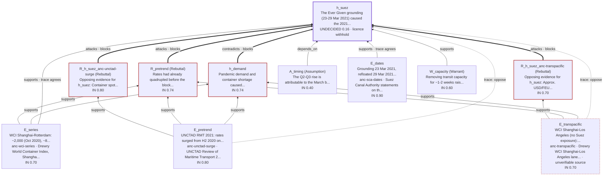

# Ever Given research tree

Question: did the March 2021 Suez blockage cause the Asia–Europe freight rate rise?
`research.yaml` shares hypothesis ids across native route models.
`source.yaml` holds source identities, lineage, anchors and recorded observations.
`trace.yaml` compares Suez and demand explanations with signed evidence links.
`logic.yaml` retains the bounded argument and its counterevidence.
`experiment.json` and `exp-obs1.json` declare finite predictions and observations.
Run `researchguard status examples/research/evergiven` (`--json` for data).
`h_yantian` appears only in experiment; its missing-logic warning is expected.
`src-wci-transpacific` is cited by title only: neither `source.yaml` nor `trace.yaml` gives it a link, DOI, ISBN or arXiv id (`trace.yaml` has `url: null`).
Status warns `unverifiable_source` for every source, old or new, that a reader outside the folder cannot look up, so this warning is expected.
No link is made up to silence it: it stays until a locator for that lane is recorded.
Numbers are approximate public-data transcriptions, not established conclusions.
`experiment observe` returns 2 (`continue_iteration`): demand and Yantian both survive; the next check is `e_yantian_timing`.

## Discussing the verdict

The owner asks: *"The blockage was huge news. Why may the answer not say it caused the rise?"*
The reply shows what the claim rests on, drawn by `researchguard status examples/research/evergiven --picture`
from this folder's models rather than from the AI's memory of the argument:

<!-- BEGIN COMPUTED PICTURE: researchguard status examples/research/evergiven --picture -->
**What h_suez rests on**

- h_suez: UNDECIDED 0.16 · licence withhold
- blocked by: R_h_suez_anc-transpacific, R_h_suez_anc-unctad-surge, R_pretrend, h_demand

Drawn: 11 boxes and 18 arrows, computed from the logic model, its evaluation, the source model and the trace route's evidence directions (readable size 12 boxes, 20 arrows).

**Not drawn**

- route states shown as text, not boxes: trace not live; experiment eliminated
- the timeline order of the trace route and the search plan are not drawn

**Problems in what is drawn**

- warning unverifiable_source:src-wci-transpacific (no link, DOI, ISBN or arXiv id; nothing outside this folder to check it against)
<!-- END COMPUTED PICTURE -->

Reply: *Two anchored pieces of evidence support the claim directly (the grounding dates and the Shanghai-Rotterdam
series), with a warrant and a timing assumption; the timeline agrees on both pieces. Four nodes block it: the
pre-trend rebuttal, the demand explanation, and two rebuttals built from the UNCTAD surge and the transpacific lane,
which had no Suez exposure but rose too. The timeline counts those two anchors against the claim as well. So the
folder licenses only "withhold": these records do not support saying the blockage caused the rise. The transpacific
lane is drawn dashed because its source is cited by title only: nobody can look it up yet, so it needs a link before
the answer leans on it. The picture leaves out the experiment route, which has eliminated the claim, and the timeline
order.*
